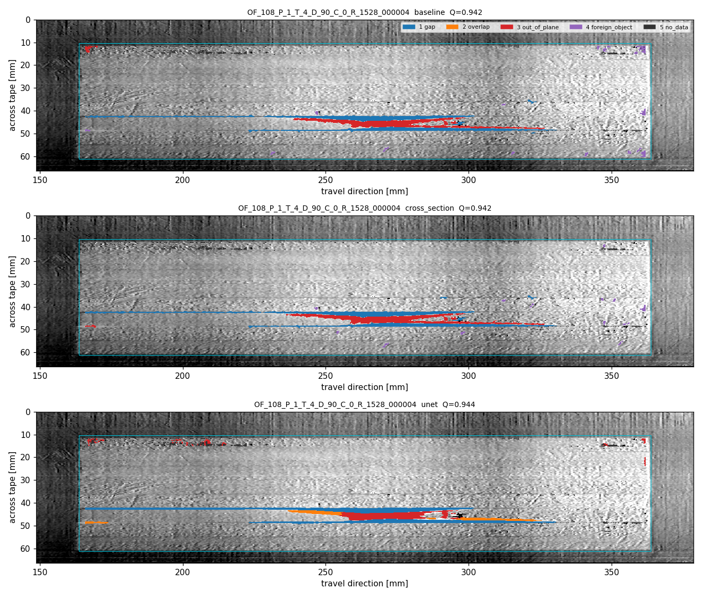

# afp-defect-inspection

Defect detection and quality assessment on laser line scans of automated
fiber placement (AFP) layups. Reads the raw export of the inspection system
of an AFP cell, finds the tape course, detects gaps, overlaps, out of plane
tows (twists, folds), foreign objects and areas without data, measures them
and computes a quality factor per course. Results go into JSON reports and a
SQLite database.

Built from my work as a student research assistant at Fraunhofer IGCV in
2023/24. Background and the original work plan:
[docs/background.md](docs/background.md).



## What is in here

| Part | Where |
|---|---|
| Reader for the AIS `.3d` scans and the `.xml` layup program (reverse engineered) | `afpscan.io`, [docs/data_format.md](docs/data_format.md) |
| Standard defect classes 0 to 5 | `afpscan.catalogue`, [docs/defect_catalogue.md](docs/defect_catalogue.md) |
| Tool surface fit (RANSAC plane, row/column model), tape localisation from the program | `afpscan.preprocess`, `afpscan.detect.baseline` |
| Rule based detector: median surface or per-profile quadratic (Tang et al. 2021), hysteresis thresholds, DBSCAN grouping | `afpscan.detect.baseline` |
| U-Net trained on synthetic scans | `afpscan.detect.unet`, `models/unet_synthetic.pt` |
| Synthetic scan generator with labelled defects | `afpscan.synth` |
| Defect area, count, quality factor Q | `afpscan.quality` |
| SQLite result database | `afpscan.database` |
| Folder watcher for online use next to the AIS | `afpscan.watch` |
| Point cloud export for CloudCompare (with defect class as scalar field) | `afpscan export-ply` |
| Evaluation and figures | `afpscan.evaluate`, `scripts/run_experiments.py`, [docs/results.md](docs/results.md) |

How it works in detail: [docs/method.md](docs/method.md).

## Results in short

On 40 synthetic test scans with 88 defects:

| | baseline | cross_section | U-Net |
|---|---|---|---|
| pixel IoU, any defect | 0.56 | 0.64 | **0.74** |
| defects found | 82 / 88 | 79 / 88 | **84 / 88** |
| object precision | 0.62 | **0.85** | 0.40 |
| error of Q | 0.0093 | 0.0089 | **0.0060** |

On the twelve real scans all methods find the same main defects on the nine
regular courses. The U-Net fails on the three scans that look unlike its
training data (heavy data loss, multi course layup); the rule based methods
stay usable there. Details and figures: [docs/results.md](docs/results.md).

## Usage

```bash
pip install -e ".[dev,dl]"

afpscan info data/raw/test025_2023-04-05/OF_108_P_1_T_4_D_90_C_0_R_1528_000004.3d
afpscan analyse data/raw/test025_2023-04-05/*.3d --db results.db --out reports --plot
afpscan analyse SCAN.3d --method unet --model models/unet_synthetic.pt
afpscan analyse SCAN.3d --method cross_section
afpscan export-ply SCAN.3d scan.ply --with-labels
afpscan watch /path/to/ais/export --db results.db --out reports
```

Training and evaluation from scratch (about 5 min for the data, 40 min for
training on a laptop CPU):

```bash
afpscan build-dataset cache/synth --workers 6
afpscan train cache/synth --model models/unet_synthetic.pt --iterations 2000
python scripts/run_experiments.py --data cache/synth
pytest
```

## Data

`data/raw` holds twelve scans recorded at Fraunhofer IGCV on 2023-04-05 with
their layup programs. The data belongs to Fraunhofer IGCV and is not covered
by the license of the code. See [data/README.md](data/README.md).

## Open points

- ATOS point clouds (task 3 of the plan) are not handled; no ATOS data was
  available.
- The height calibration of the sensor is not in the export, so heights in mm
  are approximate. Detection itself does not depend on it.
- The real scans have no labels. Labelling them would allow a real
  evaluation and fine tuning of the U-Net.

## References

- Y. Tang, Q. Wang, H. Wang, J. Li, Y. Ke: A novel 3D laser scanning defect
  detection and measurement approach for automated fibre placement. Meas. Sci.
  Technol. 32 (2021) 075201.
- O. Ronneberger, P. Fischer, T. Brox: U-Net: Convolutional networks for
  biomedical image segmentation. MICCAI 2015.
- M. Ester, H.-P. Kriegel, J. Sander, X. Xu: A density-based algorithm for
  discovering clusters in large spatial databases with noise. KDD 1996.
- M. A. Fischler, R. C. Bolles: Random sample consensus. Comm. ACM 24 (1981).

## License

Code: MIT, see [LICENSE](LICENSE). Data: see [data/README.md](data/README.md).
