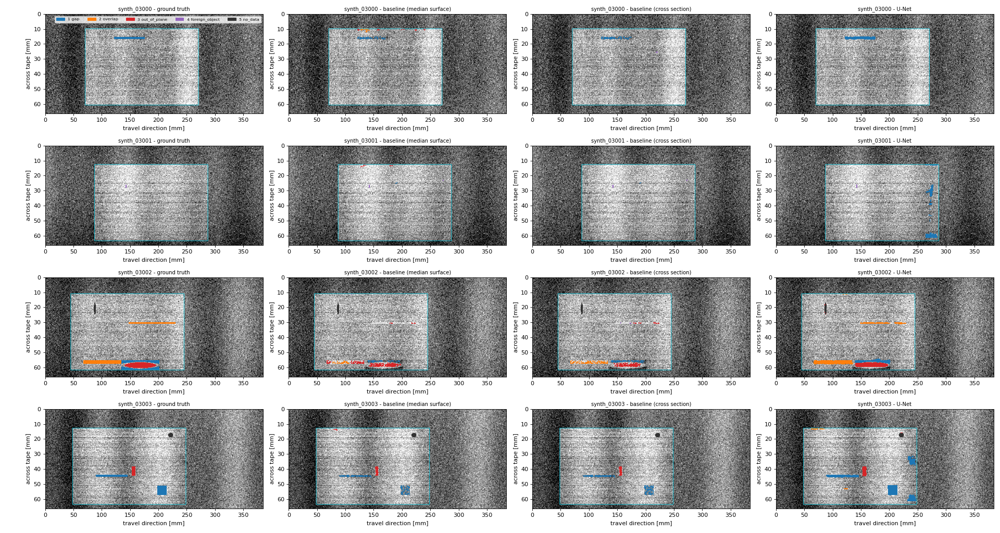
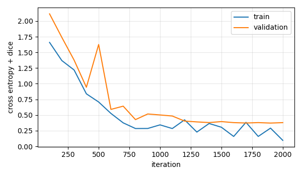
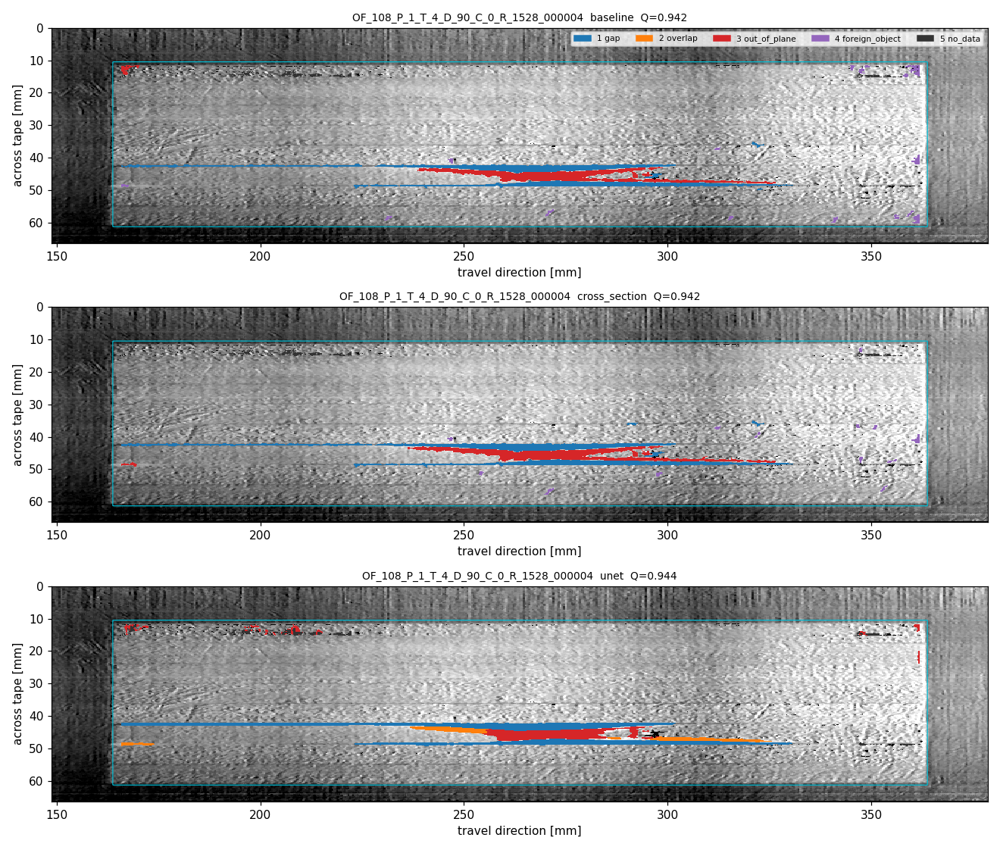
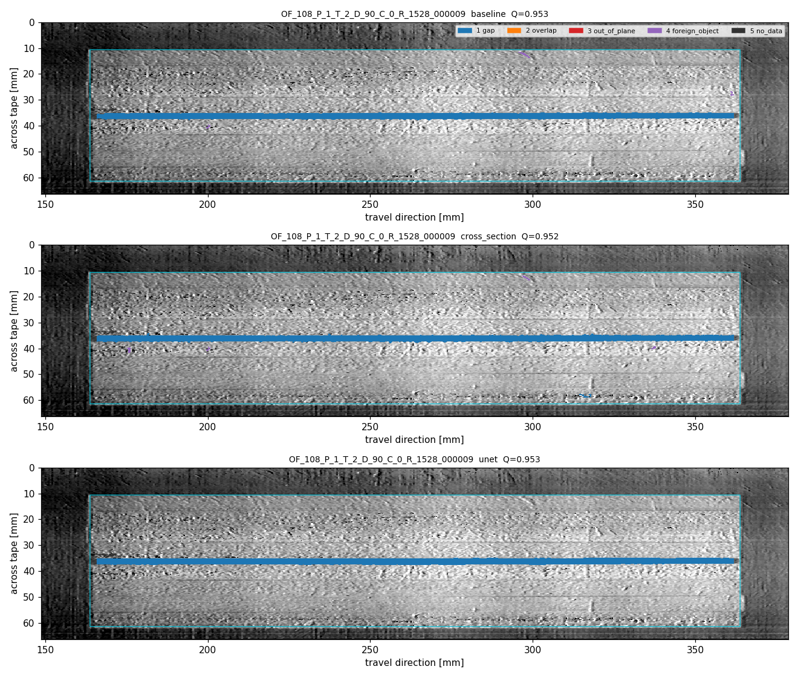
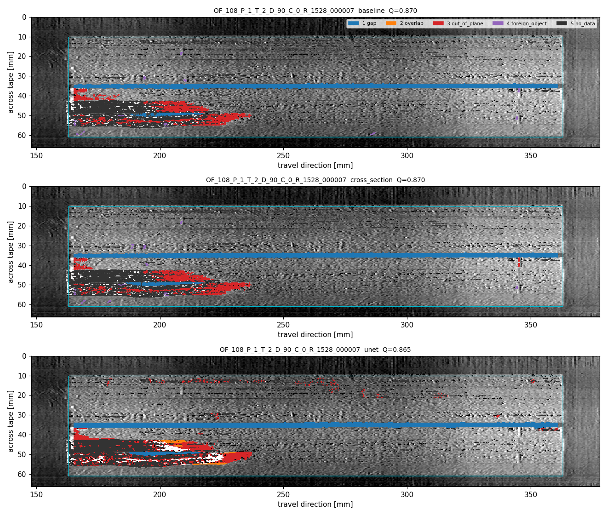

# Results

Everything here comes from `python scripts/run_experiments.py --data <cache>`
and is stored in [../results/](../results/).

Three methods are compared:

- **baseline**: rule based detector with a median filtered tape surface
- **cross_section**: the same detector with a quadratic surface fitted per
  laser profile after quantile screening (Tang et al. 2021)
- **unet**: U-Net trained on 120 synthetic scans (2000 iterations, CPU,
  41 minutes), with the same grouping, minimum area and minimum gap width

## Synthetic test set (40 scans, 88 defects)

Pixel IoU inside the tape, object recall (found / ground truth) and object
precision:

| Class | baseline IoU | recall | precision | cross_section IoU | recall | precision | unet IoU | recall | precision |
|---|---|---|---|---|---|---|---|---|---|
| gap | 0.55 | 0.90 (35/39) | 0.98 | 0.65 | 0.95 (37/39) | 0.88 | **0.70** | 0.95 (37/39) | 0.34 |
| overlap | 0.24 | 0.56 (5/9) | 0.75 | 0.38 | 0.67 (6/9) | 0.89 | **0.82** | 1.00 (9/9) | 0.31 |
| out_of_plane | 0.39 | 0.82 (23/28) | 0.35 | 0.41 | 0.68 (19/28) | 0.67 | **0.74** | 0.96 (27/28) | 0.53 |
| foreign_object | 0.16 | 0.73 (8/11) | 0.10 | 0.29 | 0.73 (8/11) | 0.21 | **0.67** | 0.73 (8/11) | 1.00 |
| no_data | 0.98 | 1.00 (8/8) | 1.00 | 0.98 | 1.00 (8/8) | 1.00 | 0.98 | 1.00 (8/8) | 1.00 |
| any defect | 0.56 | 0.93 (82/88) | 0.62 | 0.64 | 0.90 (79/88) | **0.85** | **0.74** | 0.95 (84/88) | 0.40 |

Mean absolute error of Q against the ground truth: baseline 0.0093,
cross_section 0.0089, unet **0.0060**.

What the numbers say:

- The U-Net outlines defects far better than both rule based variants
  (pixel IoU 0.74 against 0.56 and 0.64), most clearly for overlaps and out
  of plane defects, where the rules only catch the highest part. Its Q is
  the closest to the truth.
- Its object precision is low for gaps and overlaps. Most of the extra
  objects are thin seams along tow boundaries and short pieces next to real
  defects; the minimum gap width of 0.4 mm already removed the thinnest
  seams (gap precision went from 0.20 to 0.34).
- The per-profile quadratic surface beats the median surface on gaps and
  overlaps and has the best precision overall (0.85). It loses on twists,
  where the lifted tow pulls the quadratic up.
- Foreign objects smaller than about 1 mm are missed by all methods (3 of
  11): after binning they are only a few cells.
- No data areas are trivial for all three, as expected.

## Real scans (12 courses, no ground truth)

| Scan | Content | baseline Q | cross_section Q | unet Q |
|---|---|---|---|---|
| 000009 | long gap between tows 4 and 5 | 0.953 | 0.952 | 0.953 |
| 000008 | same gap | 0.953 | 0.953 | 0.903 |
| 000002 | twist | 0.951 | 0.946 | 0.928 |
| 000003 | twist | 0.947 | 0.945 | 0.918 |
| 000004 | twist | 0.942 | 0.942 | 0.944 |
| 000005 | twist | 0.944 | 0.944 | 0.941 |
| 000001 | pile-up at the start, no data shadow | 0.942 | 0.951 | 0.806 |
| 000006 | pile-up at the start, 4-tow course | 0.918 | 0.955 | 0.909 |
| 000007 | pile-up at the start and long gap | 0.870 | 0.870 | 0.865 |
| 000010 | heavy data loss over the whole tape | 0.848 | 0.839 | 0.448 |
| 000011 | heavy data loss over the whole tape | 0.842 | 0.851 | 0.551 |
| 2787_000011 | multi-course layup, 700 mm | 0.942 | 0.945 | 0.488 |

Full per class counts and areas: [../results/real_scans.csv](../results/real_scans.csv),
the same in [../results/results.db](../results/results.db) and one JSON report
per scan and method in [../results/real/](../results/real/).

What can be seen:

- On the nine regular scans all three methods find the same main findings:
  the long gap in 000007 to 000009, the twisted tow with gaps on both sides
  in 000002 to 000005, the pile-ups with their shadow at the start of 000001,
  000006 and 000007. Q of the three methods agrees within 0.03 on six of
  them.
- The U-Net calls the edges of the twist "overlap" in places, and adds small
  out of plane spots along the upper tows of 000007 that the rules do not
  see. Without labels I cannot say which is right.
- On the two scans with heavy data loss (000010, 000011) and on the multi
  course export the U-Net breaks down (Q 0.45 to 0.55): it marks large areas
  as out of plane or gap. These scans look nothing like the synthetic
  training data: dropout streaks everywhere in one case, several overlapping
  courses on curved paths in the other. The rule based methods stay
  plausible on them.
- Runtime on a laptop CPU is 2 to 4 s per course and method on average
  (baseline 2.2 s, cross_section 2.6 s, U-Net 3.8 s), at most 13 s for the
  U-Net on the 700 mm scan. That is well inside the time the robot needs to
  lay the next course.

## Limits

- The height scale is assumed (0.0015 mm per count). Detection does not
  depend on it, reported heights in mm do.
- The real scans have no labels, so every statement about them is by eye.
  Labelling the twelve courses (or at least the defect positions) would be
  the most useful next step; then the U-Net could also be fine tuned on real
  data.
- In 000001 the lower tows read at tool height over most of the course and
  the measured ply step is about half that of the other scans. Either the
  tows are really missing there or the first 140 mm without any data spoil
  the tool fit. This needs a look at the part or the process log.
- The synthetic defects are simple shapes. Real twists and folds are more
  irregular, and pile-ups are mixed with missing data in ways the generator
  only roughly copies.
